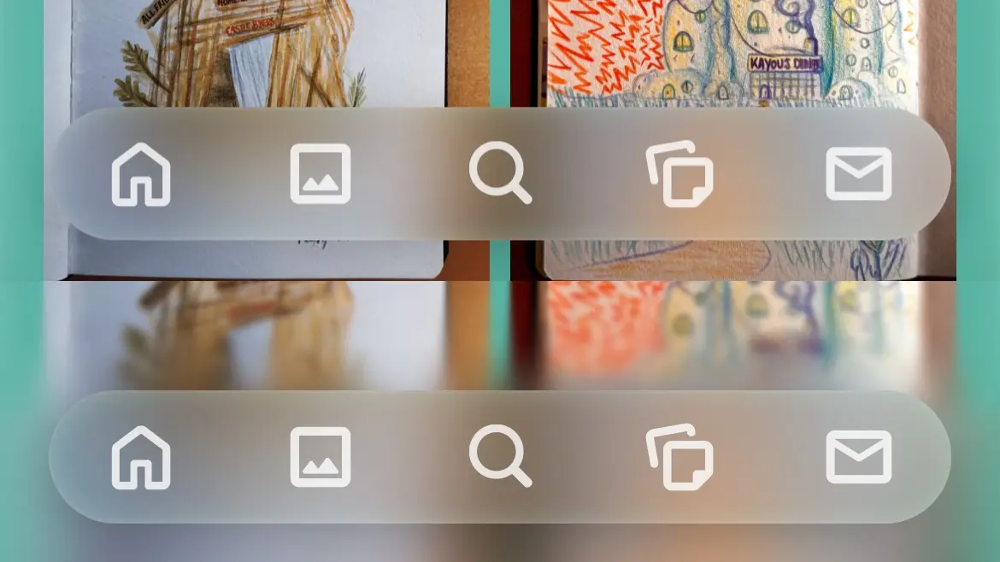

  « Il était une fois Perspikative. Perspikative avait son propre site. Mais un jour, Perspikative a décidé que son site méritait mieux. Et c’est à partir de ce jour que les Perspikativeurs découvrirent des nouveautés exaltantes… »

 

Préambule

  La Trilogie des Nouveautés est un évènement qui s'est déroulé sur Perspikative en août 2026. Depuis déjà de nombreux mois, j'améliorais le site. Au fur et à mesure que j'améliorais le site, j'accumulais des corrections de bugs, de nouvelles fonctionnalités, des nouvelles pages... Vous ne savez pas à quel point je passe des heures entières sur mon site, à tâter de nouvelles pistes. Pour moi, je ne pouvais pas me contenter d'améliorer le site par-ci par-là, sans ne rien en faire en retour. Il fallait que je transforme ces nombreuses heures de travail en un petit évènement qui donnerai de la valeur à mon travail. Et cela m'arraigeait, puisque je cherchais depuis un bon bout de temps un moyen d'annoncer une nouveauté majeure sur le site...

  La Trilogie des Nouveautés est donc découpée en trois temps. Cet évènement s'est déroulé sur trois semaines, avec un Chapitre par semaine. Et le truc encore plus cool, c'est que chaque semaine les nouveautés annoncées étaient de plus en plus extraordinaires. Je vous laisse donc plonger dans cette aventure follement créative, qui risque de vous surprendre...

 

🌱 Chapitre 1 : Lier l’Utile à l’Agréable

  Le premier chapitre est révélateur. Il ne cherche pas à impressioner, il porte bien son nom : lier l'utile à l'agréable. Ce premier chapitre apporte une base améliorée du site, des fondations plus solides pour ce qu'il y a à suivre. Cette première partie comprend l'ensemble des petites corrections apportées au site. Elle rend clairement le site plus agréable à utiliser. Ce chapitre apporte surtout une amélioration globale du site, avec divers bugs corrigés, un style global retravaillé ainsi que des animations uniformisées. 

 

<strong>1. Amélioration de la page <a href="/rechercher" target="_blank">Rechercher</a></strong>

  Depuis l'<a href="/actus/2026/nouveautes-de-la-recherche" target="_blank">article Nouveautés de la recherche</a> en avril dernier, la page possède un moteur de recherche amélioré, avec une pertinence des résultats de recherche bien plus affinée, de nouvelles fonctionnalités comme une section de mots-clés et quelques easter-eggs en plus. Cette page est en constante évolution, je suis persuadé que d'autres améliorations y seront apportées. Ce que j'aimerai faire prochainement sur cette page est l'amélioration du système d'historique de recherche, en faire quelque chose de plus complet et intégré aux <a href="/profile" target="_blank">profils Perspikative</a>. De même que je compte ajouter de nombreux autres easter-eggs, et je n'arrêterai jamais : la barre de recherche est l'endroit idéal pour cacher les surprises les plus absurdes ou dénoncer avec un peu de satire ce qui ne va pas dans notre monde.


 
<a href="{{ page.cta.url | escape }}" class="btn-glass">{{ page.cta.label | escape }}</a>
  


<strong>2. Barre de navigation retravaillée</strong>

  Ce premier chapitre étant consacré à rendre le site plus esthétique et agréable, la barre de navigation mobile en avait bien besoin. Le flou d’arrière-plan a été amélioré, les proportions de la barre ajustées, et un flou progressif a ajouté en-dessous. Ce flou progressif est probablement l'élément le plus satisfait de cette refonte de la barre de navigation. Il est discret, mais interpelle tout de même si on y fait attention. De plus, les ombres et les reflets de la barre de navigation ont été complètement revus, avec des paramètres variables en fonction du mode clair ou sombre du site (et oui, on peut faire ça). Voici un comparatif avant (en haut)/après (en bas) des changements de la barre de navigation :

  

<strong>3. La réfraction au cœur de tout</strong>

  La barre de navigation mobile ne s'arrête pas là. L'arrivée du Liquid Glass d'Apple en 2025 m'avait beaucoup interpellé. Ce nouveau système me semblait juste extraordinaire, cet effet de verre liquide si réaliste. Simplement, j'aimais beaucoup cet effet, et il se trouve qu'à ce moment là je faisais mes premiers essais de code pour mon site. Je pense que le Liquid Glass m'a beaucoup inspiré, et quelque peu influencé dans ma manière de concevoir le site. 

  Dans cet élan de rendre mon site meilleur, je pensais déjà depuis longtemps à rendre cette barre de navigation mobile beaucoup plus "iOSque", si je puis dire. Je me suis donc renseigné sur tous les éléments qui rendaient cette barre très naturelle et réaliste, en lisant plusieurs articles qui expliquaient cela. Même en trouvant ça très ingénieux, la question restait la même : comment recréer cet effet pour le web ? Un système d'exploitation et un navigateur web ne sont pas la même chose, et les navigateurs ne sont pas tous pareils (la galère vraiment). L'indice que je relevais le plus pertinent était la réfraction de l'élément. La réfraction déforme l'arrière-plan sur les bords pour donner une perspective et une impression de 3D à l'élément. J'ai alors trouvé des projets open source qui travaillait sur l'expérimentation de cette chose qu'est la réfraction. L'IA m'a également aidé à paufiner cet effet. Et ainsiest né la réfraction sur la barre de navigation mobile ! Cet effet est n'est malheureusement pas disponible sur des navigateurs comme Safari ou Firefox, mais seulement sur des navigateurs qui utilisent Chromium (Google, Samsung Internet...).

<strong>4. Les fameuses pages légales</strong>

  Ce n'est peut-être qu'un détail pour vous, mais les pages légales sont finalement les plus importantes de ce chapitre de nouveautés. En effet, elles apportent toute la clarté du site, dont certaines sont obligatoires. Avec le Chapitre final, l'arrivée d'une toute nouvelle page est primordiale : les <a href="/terms-of-service" target="_blank">conditions d'utilisation</a>. Elles instaurent les règles de base pour le bien-vivre ensemble sur le site. La modification de la <a href="/politique-de-confidentialite" target="_blank">politique de confidentialité</a> a aussi été faite minutieusement, afin de rendre clair l'utilisation de vos données (vous inquiétez pas, je vais pas vous manger ni vendre vos données). Une petite modification a également été faite dans les mentions légales <a href="/mentions-legales" target="_blank">mentions légales</a>, du côté des crédits. 

