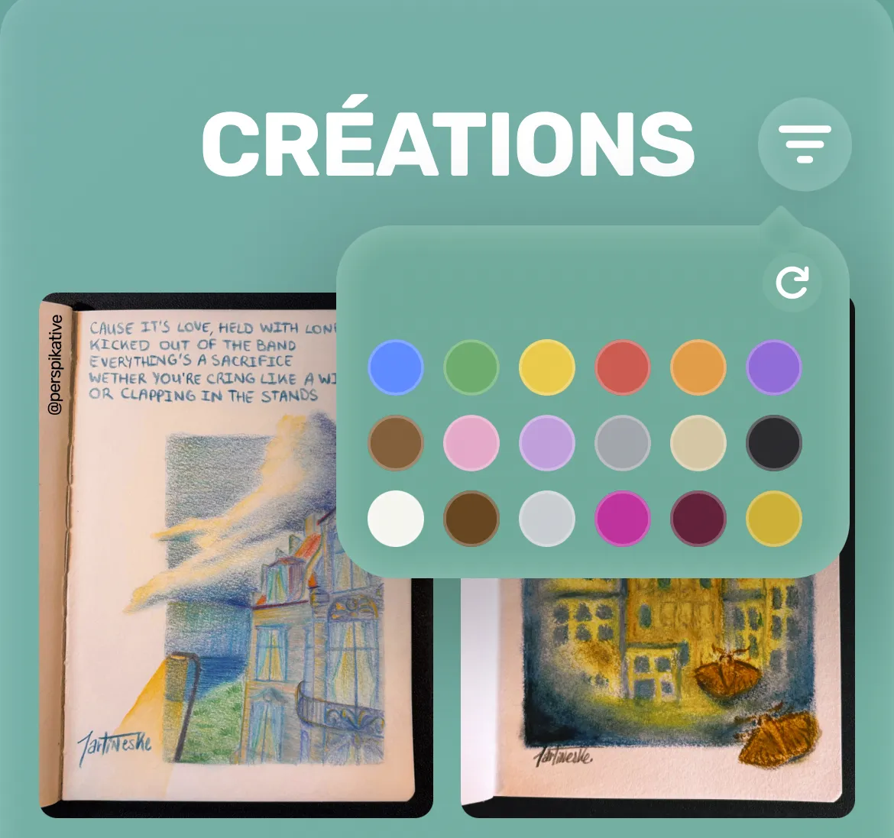
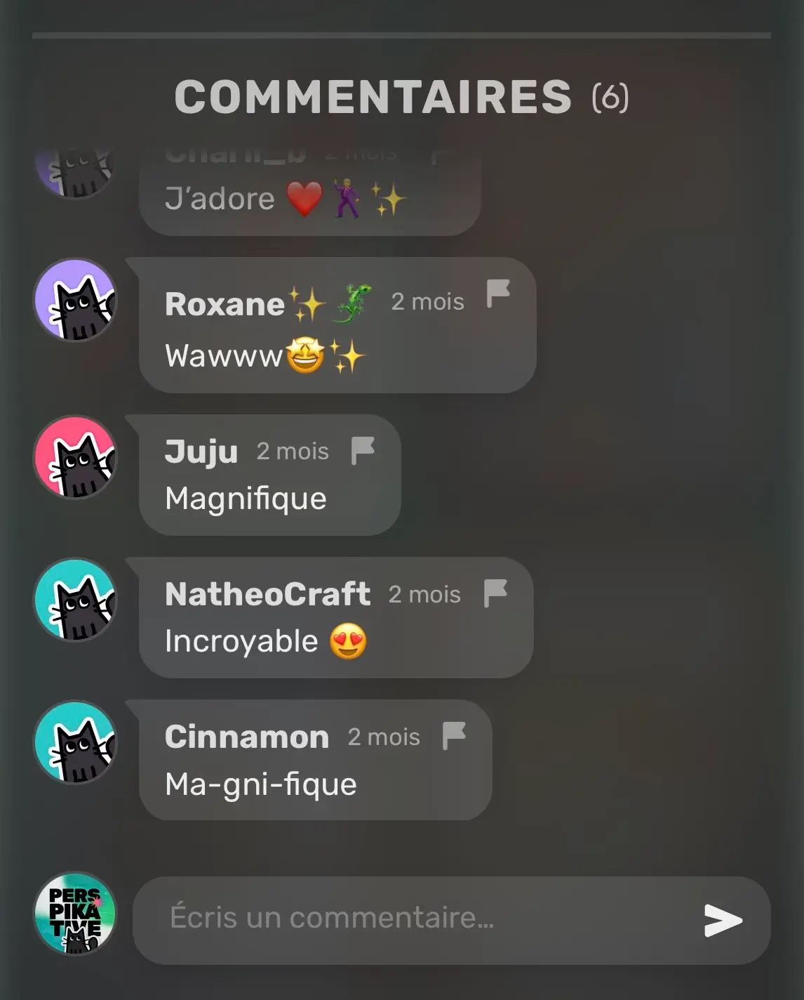

  « Perspikative continuait son périple dans l’amélioration de son site, cherchant les moindres détails qui n’allaient pas. Puis quelque chose de frappant : le portfolio ne convenait pas. Ses idées étaient différentes, Perspikative voulait quelque chose de différent. Contempler est un art, et c’est ainsi que le portfolio du site est devenu magnifique... »

 

🌱 Chapitre 2 : Contempler est un Art

  Ce second chapitre fait bien avancer les choses. Les nouveautés sont d'un ordre supérieur par rapport au <a href="/actus/2026/la-trilogie-des-nouveautes-part-1" target="_blank">Chapitre 1</a>. Une fois les bases posées, je me suis concentré sur un défi plus important : rendre le <a href="/portfolio" target="_blank">portfolio</a> encore plus extraordinaire et complet. Et ça n'a pas été une mince affaire...

 

<strong>1. Une galerie dynamique</strong>

  C'est le début de tout. Avant, les galeries du portfolio était très lourde à charger. La page chargeait simultanément 2 versions de la galerie, une version desktop (ordinateur) et une version mobile. Résultat : la page chargeait lentement, et consommait plus de données pour récupérer les éléments. La structure de la page était aussi plus conséquente. Mais j'ai décidé de remédier à ça...

  Désormais, les galeries du portfolio utilise une structure commune pour chaque version du site. Que vous consultiez le site depuis votre smartphone, tablette ou depuis un ordinateur, c'est la même structure qui est utilisée. À partir de là, le poids des pages a bien diminué. Mais ici, je parle bien de « galerie dynamique ». En fait, j'utilisais différentes structures des galeries en une même page afin de disposer les œuvres d'une certaine façon. Sur mobile, 2 colonnes, et sur version desktop 3 colonnes. Mais maintenant que j'utilise une structure commune, comment choisir la disposition de mes œuvres ? Eh bien, j'ai fais appel à 2 scripts open-source...

  Les scripts sont des bibliothèques JavaScript développées par <a href="https://desandro.com/" target="_blank">David Desandro</a>. On y retrouve la bibliothèque <a href="https://masonry.desandro.com" target="_blank">Masonry (v4)</a>, qui permet d'organiser les œuvres du portfolio en grille dynamique. Les images se replacent seules en fonction du code ; ainsi que la bibliothèque <a href="https://imagesloaded.desandro.com/" target="_blank">imagesLoaded (v5)</a>, facultative, mais qui permet de détecter le chargement des images et faciliter le calcul de la disposition des galeries.


 
<a href="{{ page.cta.url | escape }}" class="btn-glass">{{ page.cta.label | escape }}</a>
  


<strong>2. Filtrer par couleur, c'est possible</strong>

  C'est probablement l'une des fonctionnalités que je trouve le plus cool. Quelque part, c'est assez banal, mais c'est une fonctionnalité amusante (et pratique, encore heureux). Depuis les débuts du portfolio, je savais que je voulais ce petit bouton Filtrer. Et le voilà !

  

  Il vous suffit d'appuyer dessus pour qu'un panneau s'ouvre avec différentes couleurs. Le filtrage se fait par combinaisons de couleurs : toutes les couleurs que vous selectionnerez seront présentes dans les œuvres. Au plus vous sélectionnez de couleurs, au plus les résultats sont affinés. Si vous sélectionnez trop de couleurs, vous risquez de n'avoir aucun résultat (puisque jusqu'à présent, aucune œuvre ne contient toutes les couleurs présentes). Pour réinitaliser le filtre et voir toutes les œuvres par ordre chronologique, il vous suffit d'appuer sur la petite flèche Actualiser.

  Pour l'instant, il est seulement possible de trier ces œuvres par couleur. Mais plus tard, pourquoi pas les trier par années, thème ou encore popularité ? Le portfolio est plus complet ainsi, mais il manque toujours...

 

<strong>3. Des commentaires pour blablater</strong>

  Que serait Perspikative sans interactions ? Pas grand chose effectivement, même s'il faut encore que je m'améliore. Cette idée d'ajouter une section commentaires dans les lightboxs (fenêtres) de mes œuvres n'est pas d'ajourd'hui, mais je me vois enfin vous la présenter !

  

  En dessous de chaque œuvre, une section commentaire est présente.

